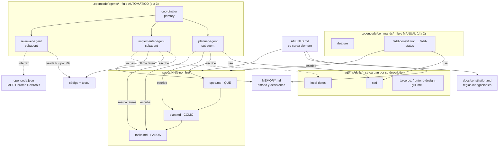

# Diario de Estudio — Manual de construcción y uso (SDD + multiagentes en OpenCode)

Manual de consulta para armar el repo desde cero y operarlo. Sigue el orden del curso
*Desarrollo con IA — El nuevo programador* (días 1, 2 y 3) y está pensado para OpenCode **V2**
(probado con 2.0.20).

**Cómo usar este manual**

- Cada paso de construcción tiene una marca: ⬜ pendiente / ✅ hecho.
- Al terminar un paso: haz un commit, marca ✅ y, si el paso creó un archivo, deja solo el
  enlace al archivo (el contenido completo queda en el repo y en el historial de git).
- La **sección 4 (ciclo de trabajo)** no se reemplaza nunca: es la que se usa en cada funcionalidad.

---

## 1. Mapa relacional de archivos



**Cómo leerlo**

| Capa | Archivos | Quién lo lee | Cuándo se crea |
|---|---|---|---|
| Contexto fijo | `AGENTS.md`, `MEMORY.md`, `docs/constitution.md` | Todos los agentes. `AGENTS.md` lo carga OpenCode solo; los otros dos porque `AGENTS.md` lo indica | Una vez por proyecto (MEMORY se actualiza al cerrar tareas) |
| Conocimiento a demanda | `.agents/skills/*/SKILL.md` | El agente, cuando la `description` encaja con la tarea | Una vez; se amplía cuando hace falta |
| Configuración | `opencode.json` | OpenCode al arrancar | Una vez |
| Formas de trabajar | `.opencode/commands/*.md` (manual) y `.opencode/agents/*.md` (automático) | Tú (comandos) o el coordinador (agentes) | Una vez |
| Artefactos por funcionalidad | `specs/NNN-nombre/spec.md`, `plan.md`, `tasks.md` | Planner, implementer, reviewer | **En cada funcionalidad** |
| Producto | código, `tests/` | Implementer y reviewer | En cada tarea |

> Idea clave: los **comandos** y los **agentes** no son dos sistemas distintos. Recorren las
> mismas 7 fases y producen los mismos 3 archivos. Con comandos, el coordinador eres tú; con
> agentes, el coordinador lanza las fases y tú apruebas en los puntos de control.

---

## 2. Estructura final del repo

```
MyStudyDiary/
├── AGENTS.md                  ← paso 2  (instrucciones fijas, 30-40 líneas)
├── MEMORY.md                  ← paso 3  (estado del proyecto, ~50 líneas)
├── opencode.json              ← paso 8  (MCP)
├── skills-lock.json           ← paso 7  (lo genera `npx skills add`)
├── docs/
│   └── constitution.md        ← paso 9  (6 principios)
├── specs/
│   └── 001-heat-map/          ← paso 10 (uno por funcionalidad)
│       ├── spec.md
│       ├── plan.md
│       └── tasks.md
├── tests/                     ← paso 10 (node --test)
├── .agents/skills/
│   ├── local-dates/SKILL.md   ← paso 6
│   ├── sdd/SKILL.md           ← paso 11
│   └── <terceros>/            ← paso 7
├── .opencode/
│   ├── commands/
│   │   ├── feature.md         ← paso 5
│   │   └── sdd-*.md (9)       ← paso 11
│   └── agents/
│       ├── coordinator.md     ← paso 12
│       ├── planner-agent.md   ← paso 12
│       ├── implementer-agent.md ← paso 12
│       └── reviewer-agent.md  ← paso 12
└── index.html, styles.css, app.js, heatmap-logic.js   ← código
```

> ⚠️ El **nombre del archivo es el ID del agente**: `planner-agent.md` se invoca como
> `@planner-agent`. En este repo los subagentes llevan el sufijo `-agent` para no confundirlos
> con comandos o skills. Ese mismo nombre, con sufijo, tiene que aparecer en los permisos del
> coordinador (`resource: "planner-agent"`) y en sus instrucciones (`@planner-agent`).

---

## 3. Paso a paso de construcción

### Fase 0 — Preparar el entorno ⬜

1. Instalar OpenCode: <https://opencode.ai/es/download>. Iniciar con `opencode` en la carpeta del proyecto.
2. `/connect` → elegir proveedor. `/models` → elegir modelo.
3. Inicializar git (`git init`) para poder hacer un commit por paso.

**Atajos útiles:** `Tab`/`Shift+Tab` cambia de agente principal (build ↔ plan ↔ los tuyos) ·
`@` referencia archivos, skills y subagentes · `!` ejecuta un comando de terminal ·
`/new` nueva sesión · `/compact` compacta · `/undo` deshace · `Ctrl+P` todos los comandos.

---

### DÍA 1 — Harness engineering: agente, contexto y plan

#### Paso 1 — Crear la aplicación base ⬜

**Agente:** build. **Crea:** `index.html`, `styles.css`, `app.js`.

Prompt con estructura clásica (Rol · Contexto · Tarea · Restricciones · Formato de salida):

```
## Rol
Actúa como desarrollador frontend senior que escribe código simple, claro y fácil de
entender para alguien que está empezando a programar.

## Contexto
Quiero crear desde cero "Diario de Estudio", una web para registrar mis sesiones de
estudio y motivarme viendo mis días seguidos estudiando. Esta es la primera
versión y tiene que ser muy simple.

## Tarea
1. Un formulario para registrar una sesión con: fecha (por defecto hoy, editable),
   tema (texto, obligatorio) y minutos (número mayor que 0, obligatorio).
2. Los días seguidos estudiando en grande, con un 🔥.
3. La lista de sesiones, de la más reciente a la más antigua.
4. Los datos guardados en localStorage para que no se pierdan al recargar.

## Restricciones y reglas
Días seguidos estudiando:
- Un día cuenta si tiene al menos una sesión.
- Los días seguidos estudiando son los días consecutivos con sesión que terminan hoy.
- Si hoy todavía no he estudiado pero ayer sí, los días seguidos estudiando siguen vivos.
- Usa siempre la fecha local del usuario, nunca UTC.
Técnicas:
- HTML, CSS y JavaScript, sin frameworks, sin librerías y sin compilar nada.
- Solo tres archivos: index.html, styles.css y app.js.
- Tiene que funcionar abriendo index.html con doble clic.
- No añadas nada que no aparezca en este mensaje.
- Diseño limpio y moderno, que se vea bien en el móvil. Textos en español.

## Formato de salida
1. Crea los tres archivos directamente en la carpeta del proyecto.
2. Responde con: resumen de 3-4 líneas, pasos para probarlo y decisiones que deba revisar.
```

**Verificar:** abrir `index.html`, registrar sesiones, recargar y comprobar que siguen ahí.

#### Paso 2 — AGENTS.md ⬜

**Crea:** `AGENTS.md`. **Cómo:** `/init` (lo genera analizando el proyecto) y después
ajustarlo a la plantilla. Máximo 30-40 líneas.

```markdown
# AGENTS.md — [Nombre del proyecto]
[Qué es, para quién y cuál es su objetivo.]

## Stack y estructura
## Comandos            ← comandos exactos y copiables
## Convenciones
## Reglas de dominio / trampas conocidas
## Forma de trabajar
## Límites             ← ✅ Siempre / ⚠️ Pregunta antes / 🚫 Nunca
## Verificación
```

**Regla de oro:** solo lo que el agente **no puede deducir leyendo el código**, y siempre
coherente con el código real (nombres de claves, archivos, comandos).

#### Paso 3 — MEMORY.md ⬜

**Crea:** `MEMORY.md` con secciones *Estado actual · Decisiones (y por qué) · Aprendizajes y
errores a evitar · Próximos pasos*. Máximo ~50 líneas.

**Modifica:** `AGENTS.md`, añadiendo:

```markdown
## Memoria
- Al empezar, lee `MEMORY.md` para conocer el estado del proyecto y las decisiones tomadas.
- Al terminar una tarea, actualízalo: estado actual, decisiones (con su porqué) y errores a evitar.
- Mantenlo breve (máximo ~50 líneas): resume o elimina lo que ya no aporte.
- Si algo se convierte en regla permanente, propón moverlo a `AGENTS.md`.
- No guardes nunca datos sensibles.
```

y en *Límites*: `✅ Siempre: actualizar MEMORY.md al terminar cada tarea.`

#### Paso 4 — Usar el modo Plan (no crea archivos) ⬜

`Shift+Tab` → agente **plan**. Úsalo para tareas grandes y refactors; no para correcciones obvias.

```
Quiero añadir la "mejor marca de días seguidos estudiando": la secuencia más larga que he conseguido nunca.
Antes de escribir código, prepárame un plan con:
1. Cómo vas a calcularla respetando las reglas de fechas y días seguidos estudiando de AGENTS.md.
2. Qué archivos vas a modificar y qué cambia en cada uno.
3. Los casos límite y las dudas que debo decidir yo antes de empezar.
4. Qué actualizarías en AGENTS.md y en MEMORY.md.
```

Cuando el plan te convence: `Shift+Tab` → **build** → "implementa el plan".

---

### DÍA 2 — Harness avanzado y Spec-Driven Development

#### Paso 5 — Primer comando personalizado: `/feature` ⬜

**Crea:** `.opencode/commands/feature.md` → archivo: [feature.md](.opencode/commands/feature.md)

Un comando es un **prompt reutilizable** que lanzas tú con `/nombre`. El agente nunca lo
ejecuta por iniciativa propia. `$ARGUMENTS` = todo lo que escribes después del comando;
`$1`, `$2` = primer y segundo argumento.

```markdown
---
description: Planifica una nueva funcionalidad antes de tocar código
agent: plan
---
Quiero añadir esta funcionalidad: $ARGUMENTS
(...plan en 4 puntos, como en el paso 4...)
Ten en cuenta el estado actual del proyecto: @MEMORY.md
No modifiques ningún archivo hasta que apruebe el plan.
```

**Uso:** `/feature mostrar el total de minutos estudiados esta semana`. Reinicia OpenCode tras crear el archivo.

#### Paso 6 — Skill propia: `local-dates` ⬜

**Crea:** `.agents/skills/local-dates/SKILL.md` → archivo: [SKILL.md](.agents/skills/local-dates/SKILL.md)

Una skill es **conocimiento que el agente carga solo cuando lo necesita**, decidiendo por la
`description`. Por eso la `description` debe decir *cuándo usarla* y estar en **una sola línea**
(o con `>-`).

```markdown
---
name: local-dates
description: Úsala siempre que escribas, modifiques o revises código que trabaje con fechas, días, semanas o días seguidos estudiando en el Diario de Estudio.
---
# Reglas · Checklist de revisión · Al terminar
```

**Verificar:** `/skills` debe listarla. Prueba: `/feature mostrar cuántos días he estudiado este mes. ¿Vas a utilizar alguna skill?`

#### Paso 7 — Skills de terceros ⬜

**Crea:** carpetas en `.agents/skills/` y `skills-lock.json`.

```bash
npx skills add vercel-labs/agent-skills
npx skills add https://github.com/anthropics/skills --skill frontend-design
```

Durante la instalación eliges los agentes y el alcance (proyecto o global).
Starter pack: `find-skills`, `grill-me`, `frontend-design`, `web-design-guidelines`, `systematic-debugging`.
**Uso:** `@frontend-design con lo que sabes mejora el diseño de la web`.

#### Paso 8 — MCP: Chrome DevTools ⬜

**Crea:** `opencode.json`. En **V2** los servidores van dentro de `mcp.servers`
(los apuntes muestran el formato V1, sin `servers`):

```json
{
  "$schema": "https://opencode.ai/config.json",
  "mcp": {
    "servers": {
      "chrome-devtools": {
        "type": "local",
        "command": ["npx", "-y", "chrome-devtools-mcp@latest", "--no-usage-statistics"],
        "timeout": { "startup": 120000 }
      }
    }
  }
}
```

`timeout.startup` evita el error *Request timed out* la primera vez que `npx` descarga el paquete.
Para un servidor remoto con clave (Context7), usa `"headers": { "CONTEXT7_API_KEY": "{env:CONTEXT7_API_KEY}" }`
y nunca la clave escrita en el archivo.

**Modifica:** `AGENTS.md`, sección *Verificación*:
`Después de cada cambio, verifica con el MCP de Chrome DevTools: abre index.html, prueba la funcionalidad, revisa la consola y comprueba la vista móvil.`

**Verificar:** `/mcps` debe mostrar `chrome-devtools` conectado.

#### Paso 9 — Constitución (SDD paso 1, una vez por proyecto) ⬜

**Crea:** `docs/constitution.md` → archivo: [constitution.md](docs/constitution.md)

```
Vamos a crear la constitución del Diario de Estudio. Es un proyecto que ya existe: lee
AGENTS.md, MEMORY.md y el código antes de proponer nada.
Proponme un docs/constitution.md con 6 principios innegociables, cortos y verificables, que
cubran: simplicidad del stack, relación entre spec y código, separación entre lógica e
interfaz, política de tests (sin instalar dependencias), protección de los datos del usuario
e idioma del código y los textos. Máximo 15 líneas. Espera mi aprobación.
```

**Modifica:** `AGENTS.md`:

```markdown
## Comandos
- Tests: `node --test`
## Reglas
- Lee `docs/constitution.md` y la spec activa (`specs/NNN-*/`) antes de tocar código.
```

#### Paso 10 — Primera spec, a mano (SDD pasos 2 a 7) ⬜

**Crea:** `specs/001-heat-map/` (spec, plan, tasks), `tests/` y el código.
Aquí se aprende el flujo copiando un prompt por fase. Son los mismos prompts que el paso 11
convierte en comandos; ver la tabla de la sección 4.

#### Paso 11 — Automatizar SDD: skill `sdd` + 9 comandos ⬜

**Crea:**
- `.agents/skills/sdd/SKILL.md` → archivo: [SKILL.md](.agents/skills/sdd/SKILL.md) (flujo, plantilla de spec, EARS, formato de plan y tareas)
- `.opencode/commands/sdd-constitution.md`, `sdd-spec.md`, `sdd-clarify.md`, `sdd-plan.md`,
  `sdd-tasks.md`, `sdd-implement.md`, `sdd-validate.md`, `sdd-change.md`, `sdd-status.md`

> Comprueba que `/sdd-spec`, `/sdd-plan`, `/sdd-tasks` y `/sdd-change` pueden escribir en
> `specs/`. Usan `agent: plan`, y en V2 ese agente tiene la edición denegada salvo en sus
> archivos de plan. Si no puede escribir, cámbialos a `agent: build`.

---

### DÍA 3 — Multiagentes y subagentes

#### Paso 12 — Crear el equipo de agentes ⬜

**Crea:** en `.opencode/agents/`:

| Archivo | `mode` | Puede | No puede |
|---|---|---|---|
| [coordinator.md](.opencode/agents/coordinator.md) | `primary` | Hablar contigo y lanzar los 3 subagentes | Editar, shell, web |
| [planner-agent.md](.opencode/agents/planner-agent.md) | `subagent` | Editar **solo** `specs/**` | Shell, web, subagentes |
| [implementer-agent.md](.opencode/agents/implementer-agent.md) | `subagent` | Editar y usar shell | Web, subagentes |
| [reviewer-agent.md](.opencode/agents/reviewer-agent.md) | `subagent` | `node --test`, `git diff`, `git status` (el resto de shell pregunta) | Editar, web, subagentes |

Estructura de cada archivo:

```markdown
---
description: SDD - <qué hace, en una línea>
mode: primary | subagent
color: "#10b981"          ← opcional, siempre entre comillas
permissions:
  - action: edit           ← regla general primero...
    resource: "*"
    effect: deny
  - action: edit           ← ...excepciones después (gana la última que coincide)
    resource: "specs/**"
    effect: allow
---

Instrucciones del agente (system prompt). Si este cuerpo queda vacío, el agente no sabe qué hacer.
```

Acciones de permiso en V2: `edit`, `shell`, `webfetch`, `websearch`, `subagent`, `skill`, `read`.
Efectos: `allow`, `ask`, `deny`.

**Verificar:** reiniciar OpenCode → `/agents` debe mostrar `coordinator` junto a build y plan;
al escribir `@` deben aparecer `planner-agent`, `implementer-agent` y `reviewer-agent`.

#### Paso 13 — Primera funcionalidad con el coordinador ⬜

Selecciona **coordinator** con `Tab` y escribe:

```
Quiero añadir un objetivo semanal de estudio: poder fijar cuántos minutos quiero estudiar
cada semana y ver cuánto llevo, para motivarme a cumplirlo. Sigue el flujo SDD completo.
```

Con `↓` ves los subagentes en ejecución; `Enter` entra en uno; `Esc` vuelve al coordinador.

---

## 4. Ciclo de trabajo — se repite en cada funcionalidad

| # | Fase | Flujo manual (comando) | Flujo automático (coordinator) | Produce | Tú haces |
|---|---|---|---|---|---|
| 1 | Constitución | `/sdd-constitution` | — (una vez por proyecto) | `docs/constitution.md` | Aprobar |
| 2 | Especificación | `/sdd-spec 002-nombre idea…` | `@planner-agent` | `spec.md` (Estado: borrador) | Responder hasta 5 preguntas |
| 3 | Clarificación | `/sdd-clarify 002-nombre` | `@reviewer-agent` (solo detecta) | Lista de problemas | **Aprobar la spec** |
| 4 | Plan | `/sdd-plan 002-nombre` | `@planner-agent` | `plan.md` | — |
| 5 | Tareas | `/sdd-tasks 002-nombre` | `@planner-agent` | `tasks.md` (≤10 tareas) | **Aprobar plan + tareas** |
| 6 | Implementación | `/sdd-implement 002-nombre T1` (una por vez) | `@implementer-agent` por tarea | Tests → código → tarea marcada | Revisar si para |
| 7 | Validación | `/sdd-validate 002-nombre` | `@reviewer-agent` | VEREDICTO | Aceptar o pedir cambios |
| ↺ | Cambio | `/sdd-change 002-nombre requisito…` | planner-agent → diff → aprobación | spec, luego plan y tareas | Aprobar el diff |
| ? | Dónde estoy | `/sdd-status 002-nombre` | — | Fase y siguiente comando | — |

**Reglas que no se saltan:** nunca pasar de fase sin aprobación · la spec manda (lo que no
está en la spec no se implementa) · un cambio entra primero en la spec · nunca avanzar con
tests en rojo · una tarea cada vez.

**Requisitos en EARS (en `spec.md`):**

```
RF-x: CUANDO <evento>, EL SISTEMA <respuesta>.
RF-x: SI <condición no deseada>, ENTONCES EL SISTEMA <respuesta>.
RF-x: MIENTRAS <estado>, EL SISTEMA <respuesta>.
RF-x: EL SISTEMA <comportamiento permanente>.
```

**Revisión en paralelo (opcional):**

```
Lanza en paralelo tres @reviewer-agent sobre la spec 002, cada uno con un foco distinto:
1. Constitución y reglas de fechas (skill local-dates).
2. Interfaz: accesibilidad y vista móvil con Chrome DevTools.
3. Tests: qué RF están cubiertos por node --test y cuáles no.
Cuando terminen los tres, junta sus resultados en un único informe, sin duplicados, con un veredicto final.
```

---

## 5. Errores comunes

| Síntoma | Causa | Solución |
|---|---|---|
| El agente/comando/skill no aparece o OpenCode da error al arrancar | `description` partida en dos líneas sin sangría (pasa al copiar del PDF) | Una sola línea, o `description: >-` con las líneas siguientes sangradas |
| El color del agente no se aplica | `color: #10b981` sin comillas: `#` es un comentario en YAML | `color: "#10b981"` |
| Los permisos no hacen efecto | `resource`/`effect` más adentro que `action`, o guiones desalineados | Alinear `resource` y `effect` justo debajo de `action` |
| El agente tiene acceso total aunque definiste permisos | El `---` de cierre está antes de `permissions` | Todas las claves dentro del frontmatter, antes del segundo `---` |
| Regla de permiso inválida | `effect` vacío o mal escrito (`den`) | `allow`, `ask` o `deny` |
| El coordinador no puede lanzar subagentes | El nombre del archivo no coincide con el `resource` del coordinador (archivo `planner-agent.md`, permiso `"planner"`) | Usar el mismo nombre en los tres sitios: archivo, `resource` y `@mención` |
| La skill nunca se usa sola | Frontmatter inválido o sin `description` | Validar el YAML; `/skills` debe listarla |
| MCP falla: *Request timed out* | `npx` tarda en descargar el paquete la primera vez | `"timeout": { "startup": 120000 }`; comprobar con `/mcps` |
| MCP no se carga | Formato V1 (`mcp.chrome-devtools`) o `"disabled": true` | V2: `mcp.servers.chrome-devtools`, sin `disabled` |
| El agente plan no crea la spec | En V2, plan no edita salvo sus archivos de plan | `agent: build` en el comando, o usar `@planner-agent` |
| El agente usa datos equivocados | `AGENTS.md` desactualizado (claves, archivos, "no hay tests") | Revisar `AGENTS.md` tras cada spec cerrada |
| Comportamientos raros del agente | Líneas sueltas copiadas del PDF dentro del cuerpo | Releer el cuerpo de cada agente/comando tras pegarlo |

---

## 6. Estado actual de este repo (revisión del 04/10/2026)

**Correcciones ya aplicadas** — pruébalas y marca ✅:

- ⬜ `cordinator.md` → `coordinator.md`; sus permisos y sus `@menciones` usan ahora
  `planner-agent`, `implementer-agent` y `reviewer-agent`. Probar: `/agents` muestra
  `coordinator` y `@` lista los tres subagentes.
- ⬜ `.agents/skills/sdd/SKILL.md`: `description` en una línea. Probar: `/skills` muestra `sdd`.
- ⬜ `.opencode/commands/sdd-implement.md`: `description` en una línea. Probar: `/sdd-implement` aparece al escribir `/`.
- ⬜ `implementer-agent.md`: borrada la línea sobrante `@explore …`.
- ⬜ `opencode.json`: quitado `"disabled": true` y añadido `timeout.startup: 120000`.
  Probar: `/mcps` muestra `chrome-devtools` conectado.
- ⬜ `AGENTS.md`: clave real `diario-de-estudio-sesiones`, menciona `heatmap-logic.js` y
  `tests/`, quitado "No hay tests automáticos" y recortado a 45 líneas.
- ⬜ Borrados `error.txt` y `output.txt` (vacíos).

**Pendiente de comprobar en tu máquina:**

- ⬜ `/sdd-spec`, `/sdd-plan`, `/sdd-tasks` y `/sdd-change` usan ahora `agent: planner-agent` +
  `subagent: false` (solo puede escribir en `specs/`); `/sdd-constitution` usa `build`.
  Probar: `/sdd-spec 002-prueba algo simple` crea `specs/002-prueba/spec.md`.
- ⬜ (Didáctico) `specs/001-heat-map/spec.md` no sigue la plantilla de la skill: sin `Estado:`,
  sin EARS y con los RF definidos en `plan.md`. Se dejó como estaba.

Ya verificado: todos los frontmatter son YAML válido · `node --test` → 7/7 en verde ·
`specs/001-heat-map` con T1–T9 completadas.
